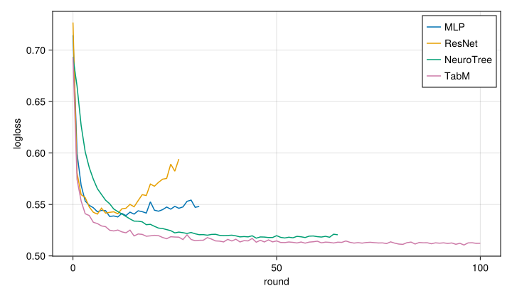

# Benchmark: higgs

Higgs (OpenML 23512): signal vs background for 98k collision events.

This report fits each architecture on the same data with the same
settings, then scores it on a held-out test set. Running it adds its
results to `quarto/benchmarks/results.csv`, which feeds the [benchmark
summary](bench-summary.md).

## Data

The data is split 70/15/15 into train, eval and test sets. Features are
standardised with the train mean and std. The eval set drives early
stopping, and the test set is only used for the final scores.

``` julia
data = load_benchmark(dataset)
(; spec, dtrain, deval, dtest, feature_names, target_name) = data
(; task=spec.task, train=nrow(dtrain), eval=nrow(deval), test=nrow(dtest), features=length(feature_names))
```

    (task = :binary, train = 68634, eval = 14707, test = 14708, features = 28)

## Models

Each architecture is close to its defaults, and training uses the
package defaults (learning rate, loss for the task) apart from the
number of rounds, the batch size and early stopping.

``` julia
archs = [
    "MLP" => MLPConfig(; hidden_size=64, stack_size=2),
    "ResNet" => ResNetConfig(; hidden_size=64, stack_size=2),
    "NeuroTree" => NeuroTreeConfig(; k=8, depth=4, ntrees=32),
    "TabM" => TabMConfig(; k=8, d_block=128, n_blocks=2),
]
settings = (; nrounds=spec.nrounds, batchsize=spec.batchsize, early_stopping_rounds=20, device, backend)
```

## Training

Each model is fitted once for one round first, so the timings below
leave out compilation.

``` julia
models, rows = Dict{String,Any}(), DataFrame()
info = run_info()
for (name, arch) in archs
    config = learner(spec.task, arch; settings...)
    warmup = learner(spec.task, arch; settings..., nrounds=1)
    NeuroTabModels.fit(warmup, dtrain; feature_names, target_name, deval, verbosity=0)

    train_time = @elapsed m = NeuroTabModels.fit(config, dtrain; feature_names, target_name, deval, verbosity=0)
    m(dtest)
    predict_time = @elapsed p = m(dtest)
    models[name] = m

    metrics = vcat(
        test_metrics(spec.task, p, dtest[!, target_name]),
        [
            "best_iter" => m.info[:logger][:best_iter],
            "train_time" => train_time,
            # early stopping sets the number of rounds, so speed is compared per round
            "time_per_round" => train_time / max(m.info[:logger][:nrounds], 1),
            "predict_time" => predict_time,
        ],
    )
    for (metric, value) in metrics
        push!(rows, (; info..., device, backend, dataset, model=name, metric, value=Float64(value)))
    end
end
record_results(rows)
```

## Results

Test-set scores, and training (in total and per round) and prediction
times in seconds.

| **model** | **logloss** | **accuracy** | **best_iter** | **train_time** | **time_per_round** | **predict_time** |
|---:|---:|---:|---:|---:|---:|---:|
| MLP | 0.554861 | 0.713829 | 11.0 | 2.66312 | 0.0859071 | 0.213959 |
| ResNet | 0.594723 | 0.70737 | 6.0 | 4.69819 | 0.1807 | 0.291089 |
| NeuroTree | 0.525552 | 0.736266 | 45.0 | 8.23265 | 0.126656 | 1.03066 |
| TabM | 0.513278 | 0.745173 | 96.0 | 7.12874 | 0.0712874 | 0.333534 |

Run on NeuroTabModels 0.5.0 (d547a0f), Julia 1.12.6, gpu, reactant,
2026-10-18 17:19.

## Learning curves

The eval metric at each round. Training stops after 20 rounds without
improvement.


